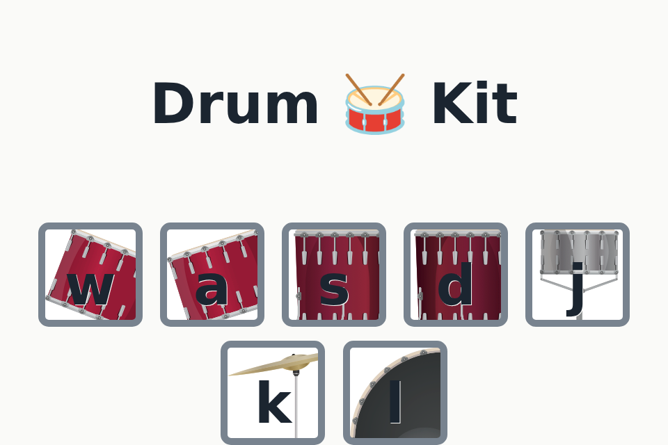

# Drum Kit

Drum Kit also known as drum set but using keyboard press or by clicking the parts of drum to produce sounds. You can play it as long as you want.

## Built with:

- HTML5
- CSS3
- JavaScript

Visit the [live preview](https://gbgabiola.github.io/ui-kit/demos/drum-kit).

## Future Improvements:

- [ ] Improved the ui/ux design of the app.
- [ ] Add some more animations on it.
- [ ] Add some other functions to it.

## How to Contribute?

Choose what you prefer:

- Open an [issue](https://github.com/gbgabiola/ui-kit/issues).
- Contact me on [twitter](http://twitter.com/genesisgabiola).

Any queries, suggestions, issues to report or critics are welcome :) You can freely connect to me.