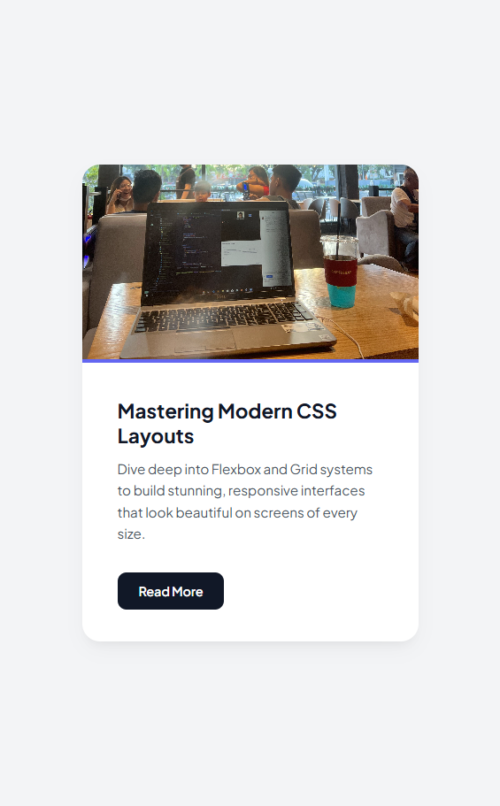

# Blog Post Card

A sleek, modern, and fully responsive Blog Post Card Component built using semantic HTML5 and modern CSS3 features. This layout features polished typography, premium card-lift hover effects, and precise image framing controls.

## 🛠️ Tech Stack

* HTML5
* CSS3

---

## 📸 Preview

Visit the [Live Preview](https://gbgabiola.github.io/ui-kit/vanilla/blog-post-card)

For local development and contribution checks, see [CONTRIBUTING.md](../../../CONTRIBUTING.md).
