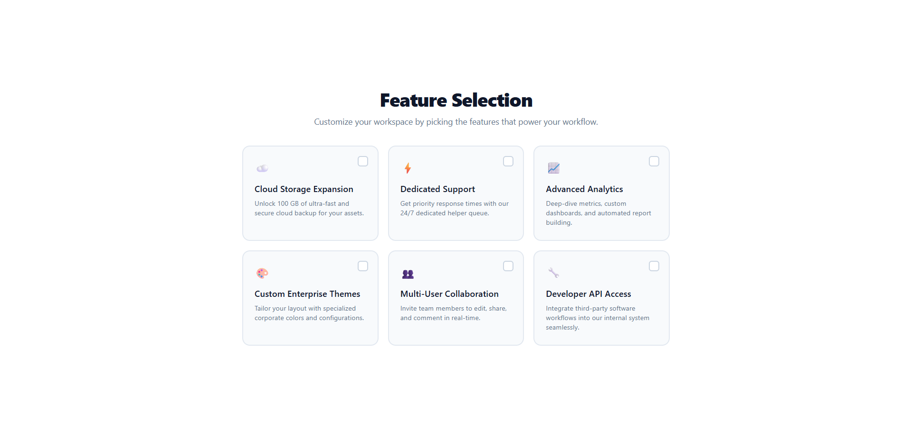

# Feature Selection Component

A clean, semantic user interface module for multi-item selection in billing or configuration workflows.

## 🛠️ Tech Stack

* HTML5
* CSS3

---

## 📸 Preview

Visit the [Live Preview](https://gbgabiola.github.io/ui-kit/vanilla/feature-selection)

For local development and contribution checks, see [CONTRIBUTING.md](../../../CONTRIBUTING.md).
